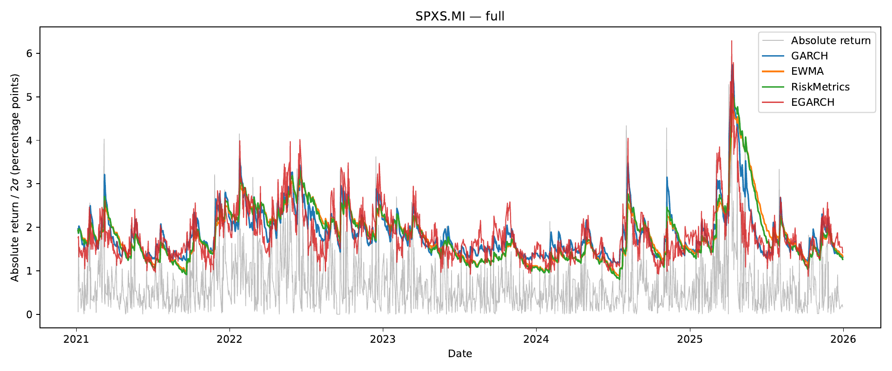
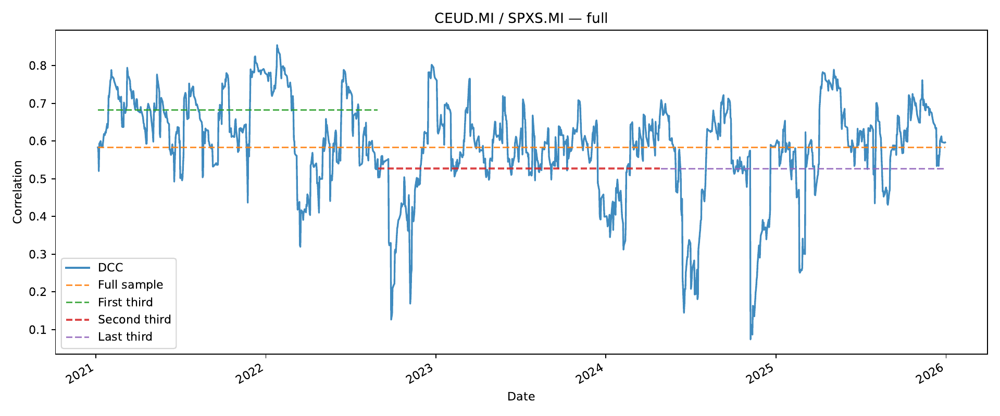

# EQF Assignment 2 - Volatility

**Team project** (two students). **My part:** the data preparation, the GARCH, EWMA and RiskMetrics models, the volatility plots and density forecast checks, and the dynamic conditional correlation model with robust standard errors. A teammate wrote the EGARCH model selection, which I later revised.

> The code and detailed result tables are not public. The course coordinator asked that assignment solutions stay off public repositories, so that future students cannot copy them; this page only describes the project.

## Question

How should the volatility of two equity ETFs, and the correlation between them, be modelled?

## Approach

- Two equity ETFs listed on Borsa Italiana, one tracking the euro area and one the S&P 500, with daily returns from 2021 to 2025.
- Univariate models: GARCH(1,1), EWMA, RiskMetrics and EGARCH, estimated by maximum likelihood, with the EGARCH orders chosen by an information criterion.
- Diagnostics: Ljung-Box tests on the standardised residuals and PIT histograms.
- Correlation: constant correlations of the standardised residuals and a dynamic conditional correlation (DCC) model.

## Main conclusion

Volatility clusters and is highly persistent. Negative shocks raise volatility more than positive ones, so the asymmetric EGARCH fits best. The correlation between the two markets is far from constant and rises in periods of market stress.

