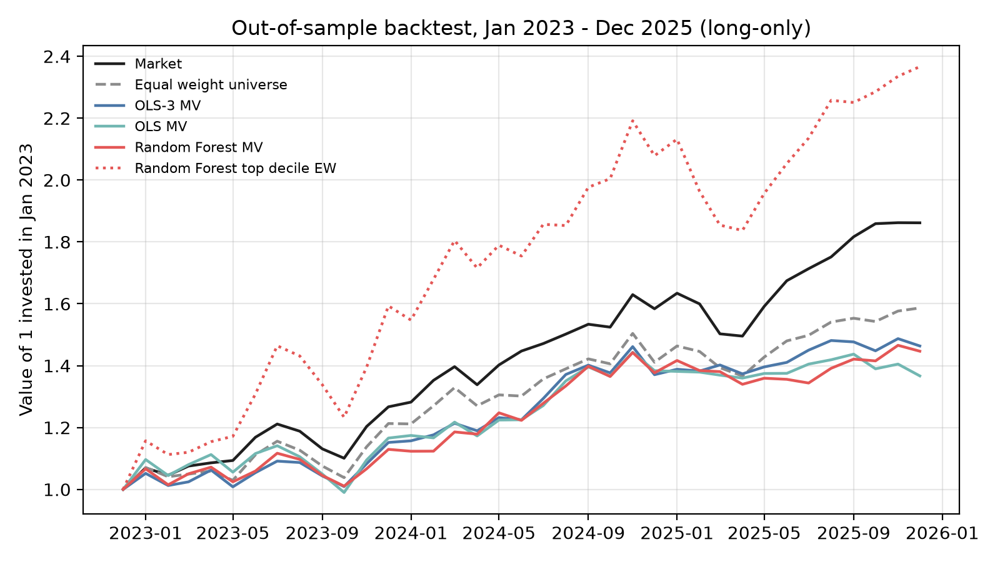

# QI Part 3 - Machine learning return forecasts (Gu, Kelly and Xiu, 2020)

**Team project** (three students). **My part:** the data preparation (`lib/data_preparation.py`): choosing the 12
characteristics, building them from CRSP and the WRDS Financial Ratios Suite, and cleaning them. Teammates wrote the
models, the portfolio construction and the backtest.

Run `python main.py` from the project folder. It prepares the data, fits OLS-3, OLS and Random Forest,
backtests portfolios built from their forecasts and writes the hand-in sheet (Part III, column N) to
`outputs/Hand_in_sheet.xlsx`. The last step needs the course's blank template (see Data).

## Data preparation
- `lib/data_preparation.py`: 12 monthly characteristics: recent return, 6- and 12-month momentum, market
  capitalization, dollar trading volume, volatility of daily returns, 60-month market beta, book-to-market,
  gross profitability, debt-to-assets, accruals-to-assets and dividend yield. Each is ranked to [-1, 1] within
  each month; missing financial ratios are filled with the same-month median.

## Modeling
- `lib/return_models.py`: train up to Dec 2020, validation 2021-2022, test 2023-2025. RF tuned on validation R^2.

## Portfolio construction and backtest
- `lib/covariance_model.py`: monthly covariance from 3 years of daily returns with Ledoit-Wolf shrinkage (as in Part II).
- `lib/portfolio.py`: long-only tangency portfolio (10% cap per stock) and risky share `(E[r] - rf) / (gamma * var)`, gamma = 4.
- `lib/backtest.py`: monthly out-of-sample backtest Jan 2023 - Dec 2025 for each model. Mean-variance portfolio,
  GKX decile sorts (top decile long-only; 10-1 spread only as a forecast check since we cannot short),
  benchmarks (market, equal weight), Sharpe, CAPM alpha, turnover.
- `lib/export_portfolio.py`: final Jan 2026 portfolio from the RF forecast, whole shares at the 31-12-2025 prices,
  the remainder at the 1% risk-free rate.

Outputs: `backtest_summary.csv`, `backtest_deciles.csv`, `backtest_returns.csv`, `backtest_wealth.png`,
`backtest_weights.csv`, `backtest_diagnostics.csv`, `portfolio_summary.csv`, `holdings.csv`, `Hand_in_sheet.xlsx`.

## Results

Team project; numbers from the submitted summary. Test period 2023-2025.

| Model | R² in sample | R² out of sample |
|---|---:|---:|
| OLS-3 (size, book-to-market, momentum) | 2.64% | 0.82% |
| OLS (12 characteristics) | 2.86% | 0.81% |
| Random forest | 3.62% | 1.31% |

- **Forecasts:** the extra characteristics improve the linear model in sample but not out of sample. Only the random forest ranks stocks usefully: its top forecast decile earned 31% a year against 11% for the bottom decile, while the OLS rankings are close to noise.
- **Portfolio:** the mean-variance portfolio built on the random-forest forecasts returned 13.1% a year (Sharpe ratio 0.68) against 23.0% (1.34) for the market. The forecasts differ little across stocks, so the covariance matrix drives the weights; the portfolio turned defensive (beta 0.68) and missed the 2023-2025 rally led by large growth stocks.
- **Top decile:** simply holding the top decile would have returned 33% a year, but with a beta of 1.48 and no significant alpha: the gain came from market risk, not stock picking.
- **Limitation:** for January 2026 the optimizer expects a Sharpe ratio of 2.4, far above the 0.68 realised in the backtest, which suggests it trusts the forecasts too much.

## Data

Not included. The CRSP, Compustat and Fama-French data are licensed through WRDS; download them with your own
access. The code reads these files from `data`:

| File | Content |
|---|---|
| `crsp_monthly_2011_2025.csv` | CRSP monthly stock data |
| `crsp_daily_2016_2025_reused.csv` | CRSP daily returns (volatility, covariance) |
| `wrds_financial_ratios_numeric_2015_2025.csv` | WRDS Financial Ratios Suite (book-to-market, profitability, leverage, accruals, dividend yield) |
| `ff_monthly_2011_2025.csv` | Fama-French monthly market excess return and risk-free rate |
| `legacy_stock_otc_prices_raw.csv` | OTC prices for stocks that left their exchange |
| `assignment_tickers_2025.txt` | The course's list of investable tickers |
| `portfolio_template_part2.xlsx` | The course's hand-in sheet, for the final export only |
