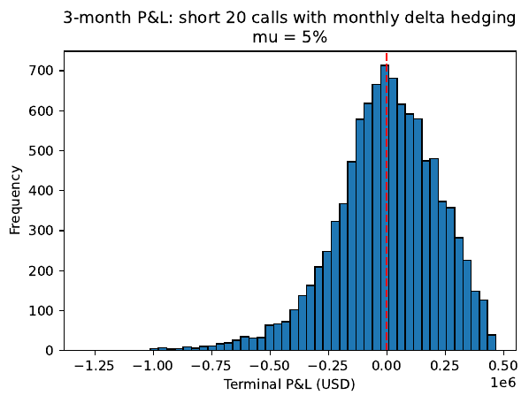
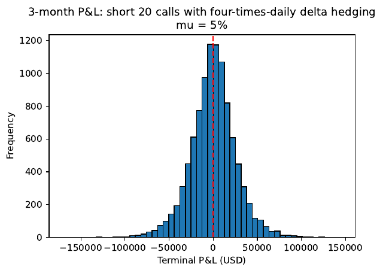

# SPF Computer Assignment - Dynamic Hedging

**Team project** (two students). **My part:** the Black-Scholes pricing and path simulation (`lib/callmodel.py`) and the hedging simulations in `main.py`. My teammate wrote the extensions for parts (a), (g) and (i) and the summary script.

A trader sells 20 European call contracts on the S&P 500 (2,000 index units) and delta-hedges them in a Black-Scholes world. The code simulates the hedge under the real-world measure and studies how the hedging error depends on the rebalancing frequency and the growth rate.

## How to run

Use Python 3.12 and run the scripts from this folder, because they read `data/SP500.csv` relative to it.

```bash
python -m pip install -r requirements.txt
python main.py
```

| Script | Content |
|---|---|
| `main.py` | Hedging with monthly to four-times-daily rebalancing: P&L histograms and hedge paths; put price by replication and put-call parity |
| `main_agi.py` | Parts (a), (g) and (i): premium, gamma of the position, risk-neutral Monte Carlo put price |
| `main_summary.py` | Summary table of all scenarios and a large-sample check with 200,000 paths |

Figures are saved in `img`.

## Results

Team project; numbers from the submitted report. Strike 7,750, maturity three months, index at 7,685, volatility 15.38% a year (72 monthly log returns), interest rate 2.989% continuously compounded.

- **Premium:** the Black-Scholes call price is 232.13 per index unit, so the trader receives USD 464,268.62 for 20 contracts.
- **Hedging frequency:** the mean terminal P&L is close to zero at every frequency; the risk is the spread around it. Its standard deviation (10,000 paths, growth rate 5%) falls roughly with 1/√n, n = number of rebalancing dates:

  | Rebalancing | Dates | Std. dev. of terminal P&L (USD) |
  |---|---:|---:|
  | Monthly | 3 | 222,183 |
  | Weekly | 13 | 112,328 |
  | Daily | 63 | 52,669 |
  | Four times a day | 252 | 25,992 |

  | Monthly hedging | Hedging four times a day |
  |---|---|
  |  |  |

  Note the different scales: the monthly histogram runs to about USD 1.25 million, the other to USD 150,000.

- **Growth rate:** a growth rate of 10% or 20% instead of 5% hardly changes the results, because the price and the delta do not depend on it and the hedge removes the exposure to the direction of the index.
- **Gamma:** the remaining error comes from gamma. The trader is short gamma, so she loses when the index moves more than the volatility that was priced in.
- **Put pricing:** the Black-Scholes put price is 239.442. Replication with 10,000 paths of 252 steps gives 239.441 (standard error 0.129); risk-neutral Monte Carlo gives 242.395 with 10,000 draws (3.366) and 239.385 with 2.52 million draws (0.209). Both converge to the no-arbitrage price.
- **Limitations:** a simulated Black-Scholes world with constant volatility and no transaction costs, which would penalise frequent rebalancing.

## Data

Not included. `data/SP500.csv` holds monthly S&P 500 closing levels from August 2020 to August 2026 (columns `observation_date`, `SP500`), as downloaded from FRED (series `SP500`, monthly, end of period). They are only used to estimate the volatility.
